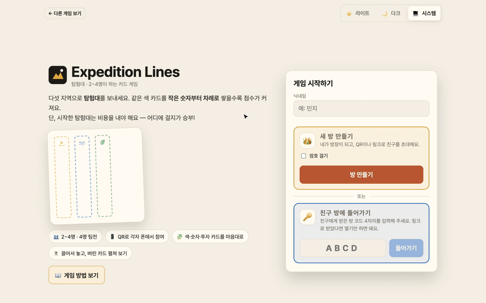
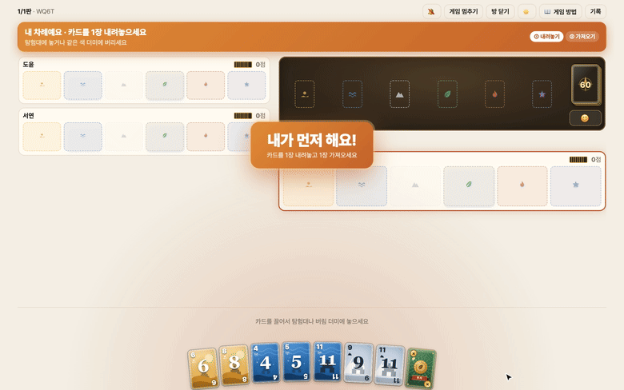
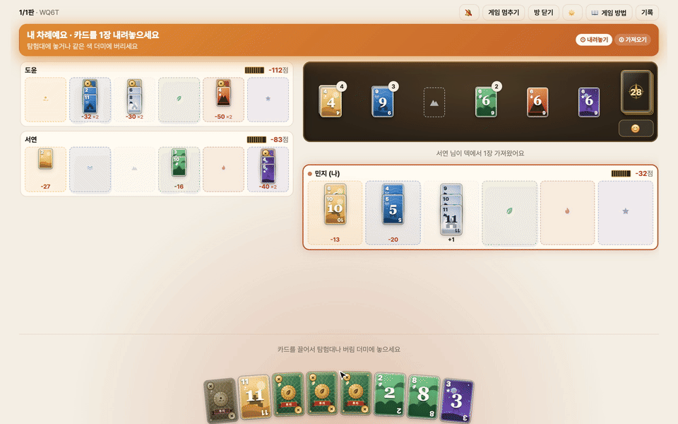
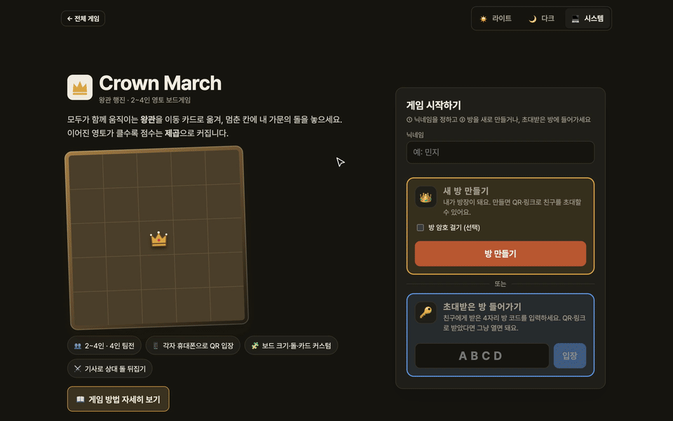
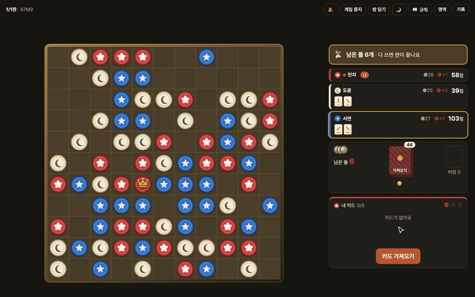

# 보드게임 테이블

친구들과 **각자 휴대폰으로** 바로 즐기는 온라인 보드게임 모음. 방을 만들고 QR을 보여 주면 모두 같은 판에 들어온다. 회원가입·설치 없음.

**바로 플레이:** https://boardgame.shinkeonkim.com

<p align="center"></p>

| 게임 | 인원 | 시간 | 한 줄 소개 |
|---|---|---|---|
| [Expedition Lines · 탐험대](https://boardgame.shinkeonkim.com/games/expedition-lines) | 2~4 | 15~30분 | 같은 색 카드를 작은 숫자부터 쌓아 탐험대를 키우는 손패 관리 카드 게임 |
| [Crown March · 왕관 행진](https://boardgame.shinkeonkim.com/games/crown-march) | 2~4 | 20~30분 | 모두가 함께 움직이는 왕관을 옮겨 영토를 넓히는 추상 전략 게임 |

게임 규칙 메커니즘은 고전 보드게임에서 영감을 받았고, 이름·그림·화면은 모두 직접 만들었다.

## 미리보기

### 포털 — 게임 찾기, 라이트/다크 전환


### Expedition Lines

| 첫 화면 · 게임 방법 | 끌어서 내려놓기 |
|---|---|
|  |  |
| **버림 더미 펼쳐보기** | **마지막 차례와 점수표** |
|  |  |

### Crown March

| 첫 화면 · 게임 방법 | 카드로 왕관 옮기기 |
|---|---|
|  |  |
| **기사로 상대 돌 뒤집기** | **남은 돌 경고와 결과** |
|  |  |

### 휴대폰

 

> 영상·GIF는 `npm run build && npm run media`로 실제 앱을 봇과 함께 돌려 2배 픽셀로 녹화한 것이다 (`scripts/media/`).

## 모든 게임에 공통인 것 (플랫폼)

- 방 코드 4자리 + QR/공유 링크, 선택적 방 암호, 관전, 끊겨도 같은 기기로 다시 열면 자동 복귀, 방장 승계·강퇴·순서 변경
- 방장의 규칙 설정(프리셋 + 세부 조절), 게임 중지 → 설정 바꿔 이어서 하기, 판 수·턴 제한시간, 끊긴 차례 대신 진행
- 차례 배너·전환 스플래시·알림음·진동, 감정 표현(🍵 티배깅 같은 약올리기 포함), 게임 방법 모달(그림·영상)
- 기기 화면에 고정되는 반응형 레이아웃, 라이트/다크/시스템 테마(포털·게임 공유)
- **무중단 배포**: 롤링 업데이트 때 새 서버가 이전 서버의 방 상태를 넘겨받아 진행 중인 게임이 끊기지 않는다

## 구조

```
packages/core     GameModule 계약 · 방 화면 타입 · 감정 표현 · 게임 카탈로그 · 검색
packages/server   게임 무관 방 서버 (Rooms, createGameServer, 무중단 배포 handoff)
packages/ui       디자인 시스템 (토큰·테마·공용/게임 컴포넌트) — README, 포털 /design
packages/web      게임 웹 키트 (첫 화면·초대·로비·재접속·게임 방법 틀)
games/<id>/       engine · server · web · meta.ts · deploy/   ← 게임마다 따로 배포
apps/portal/      홈 · 게임 찾기 · 상세 · /design · deploy/
```

자세히: [`docs/architecture.md`](docs/architecture.md) · 디자인 시스템: [`packages/ui/README.md`](packages/ui/README.md) ·
**새 게임 추가 절차와 노하우: [`.claude/skills/new-boardgame/SKILL.md`](.claude/skills/new-boardgame/SKILL.md)** ·
문구 쓰는 법: [`docs/ux-writing.md`](docs/ux-writing.md) ·
게임별 규칙 조사·설계·QA: [`docs/games/`](docs/games)

## 개발

```bash
npm install
npm test              # 엔진(+퍼즈)·방 흐름·검색 테스트
npm run typecheck
npm run build && npm run local   # 운영처럼 경로로 나눠 http://localhost:8080 (포털 + 모든 게임)
npm run media         # README·포털 표지·게임 방법 영상 다시 녹화 (ffmpeg + 크롬, PW_CHROMIUM=크롬 경로)
```

게임 하나만 개발 서버로: `npm run dev -w @bg/<id>-server` + `npm run dev -w @bg/<id>-web`.

## 배포

- 서브 프로젝트(포털·각 게임)마다 `release-<target>.yml` → `ghcr.io/shinkeonkim/boardgame-<target>:sha-xxxx` → `<dir>/deploy/kustomization.yaml` 태그 갱신 → ArgoCD(oh-my-homelab `helm-charts/apps/boardgame-<target>.yaml`).
- 공개: Cloudflare Tunnel `boardgame.shinkeonkim.com` → Traefik이 경로로 나눔 (`/<게임id>` → 게임, 나머지 → 포털). 게임을 추가해도 터널은 그대로.
