# 보드게임 테이블

친구들과 **각자 휴대폰으로** 바로 즐기는 온라인 보드게임 모음. 방을 만들고 QR이나 링크를 보내면 모두 같은 판에 들어온다. 회원가입·설치 없음, 사람이 모자라면 봇과.

**바로 플레이:** https://boardgame.shinkeonkim.com

<p align="center"></p>

## 게임

<!-- games:start -->

**주사위**

| 게임 | 원작 | 인원 | 시간 | 봇 | 한 줄 소개 |
|---|---|---|---|---|---|
| [Bluff Dice · 허풍 주사위](https://boardgame.shinkeonkim.com/games/bluff-dice) | 라이어 다이스 | 2~8 | 15~25분 | ○ | 컵 속에 숨긴 주사위로 「몇 개 이상」을 걸고, 거짓말을 잡아내는 눈치 게임 |
| [Yacht Dice · 요트 다이스](https://boardgame.shinkeonkim.com/games/yacht) | 요트 | 1~8 | 10~25분 | ○ | 주사위 5개를 세 번까지 굴려 족보 칸을 채우는 고전 주사위 게임 |

**단어 · 그림**

| 게임 | 원작 | 인원 | 시간 | 봇 | 한 줄 소개 |
|---|---|---|---|---|---|
| [Cipher Ops · 암호 작전](https://boardgame.shinkeonkim.com/games/cipher-ops) | 코드네임 | 4~10 | 15~25분 | ○ | 팀장만 아는 정답 지도를 한 단어 힌트로 전하는 팀 대항 단어 연상 게임 |
| [One Word · 한 단어](https://boardgame.shinkeonkim.com/games/one-word) | 저스트 원 | 3~8 | 15~25분 | ○ | 겹치지 않는 힌트 한 단어로 함께 맞히는 협력 파티 게임 |
| [Sketch Quiz · 그림 퀴즈](https://boardgame.shinkeonkim.com/games/sketch-quiz) | 픽셔너리 | 2~10 | 10~30분 | 사람끼리 | 한 명이 그리고 모두가 맞히는 실시간 그림 퀴즈 — 초성 힌트와 우리끼리 단어 |

**블러핑 · 추리**

| 게임 | 원작 | 인원 | 시간 | 봇 | 한 줄 소개 |
|---|---|---|---|---|---|
| [Court Intrigue · 궁정 음모](https://boardgame.shinkeonkim.com/games/court-intrigue) | 쿠 | 2~6 | 10~20분 | ○ | 가진 척, 아닌 척 — 역할을 주장하고 거짓말을 도전으로 밝혀내는 허풍 게임 |
| [Flare Signals · 불꽃 신호](https://boardgame.shinkeonkim.com/games/flare-signals) | 하나비 | 2~6 | 20~30분 | ○ | 내 카드만 못 보는 채로 힌트를 주고받으며 함께 불꽃놀이를 완성하는 협력 게임 |
| [Hidden Thorn · 숨은 가시](https://boardgame.shinkeonkim.com/games/hidden-thorn) | 스컬 | 2~8 | 15~30분 | ○ | 장미 사이에 가시를 숨기고 「몇 장 뒤집을 수 있다」고 거는 순수 블러핑 게임 |
| [Hold'em · 홀덤](https://boardgame.shinkeonkim.com/games/holdem) | 텍사스 홀덤 | 2~9 | 20~60분 | ○ | 손패 2장과 바닥 5장으로 겨루는 텍사스 홀덤 — 돈이 오가지 않는 칩 게임 |
| [Number Vault · 숫자 금고](https://boardgame.shinkeonkim.com/games/number-vault) | 다빈치 코드 | 2~6 | 15~25분 | ○ | 오름차순으로 놓인 가려진 숫자 타일을 색과 위치로 추리해 맞히는 게임 |
| [Orbit Tasks · 궤도 임무](https://boardgame.shinkeonkim.com/games/orbit-tasks) | 더 크루 | 3~5 | 10~40분 | ○ | 말없이 손발을 맞춰 과제 카드를 맡은 사람이 가져가게 하는 협력 트릭 게임 |
| [Sealed Letter · 비밀 편지](https://boardgame.shinkeonkim.com/games/sealed-letter) | 러브레터 | 2~6 | 10~20분 | ○ | 손에 든 단 한 장을 지키며 추측·엿보기·결투로 상대를 떨어뜨리는 짧은 추리 게임 |
| [Secret Mission · 비밀 원정대](https://boardgame.shinkeonkim.com/games/secret-mission) | 레지스탕스 | 5~10 | 20~40분 | ○ | 숨은 첩자를 찾아라 — 원정대 투표와 몰래 낸 카드로 추리하는 5~10인 파티 게임 |
| [Trio Hunt · 셋 찾기](https://boardgame.shinkeonkim.com/games/trio-hunt) | 트리오 | 3~6 | 10~20분 | ○ | 가장 작은 카드? 가장 큰 카드? 같은 숫자 세 장을 뒤집어 모으는 기억력 게임 |

**전략 · 퍼즐**

| 게임 | 원작 | 인원 | 시간 | 봇 | 한 줄 소개 |
|---|---|---|---|---|---|
| [Corner Claim · 모서리 땅따먹기](https://boardgame.shinkeonkim.com/games/corner-claim) | 블로커스 | 2~4 | 20~30분 | ○ | 내 조각끼리는 모서리로만 — 21개 조각을 펼쳐 판을 차지하는 공간 퍼즐 |
| [Crown March · 왕관 행진](https://boardgame.shinkeonkim.com/games/crown-march) | 장미전쟁 | 2~4 | 20~30분 | ○ | 모두 함께 쓰는 왕관을 옮기며 내 땅을 넓히는 전략 게임 |
| [Domain Tiles · 영지 도미노](https://boardgame.shinkeonkim.com/games/domain-tiles) | 킹도미노 | 2~4 | 15~25분 | ○ | 땅 도미노를 골라 5×5 왕국을 짓는 가벼운 타일 게임 — 같은 땅 크기 × 왕관이 점수 |
| [Gem Guild · 보석 상단](https://boardgame.shinkeonkim.com/games/gem-guild) | 스플렌더 | 2~6 | 30~45분 | ○ | 보석으로 카드를 사고, 카드 보너스로 더 비싼 카드를 사는 엔진 만들기 게임 |
| [Number Runs · 숫자 잇기](https://boardgame.shinkeonkim.com/games/number-runs) | 루미큐브 | 2~6 | 30~60분 | ○ | 같은 색 연속·같은 숫자로 묶어 내고, 테이블을 다시 짜 손을 비우는 숫자 타일 게임 |
| [Tile Atelier · 타일 공방](https://boardgame.shinkeonkim.com/games/tile-atelier) | 아줄 | 2~4 | 30~45분 | ○ | 공장에서 한 색을 통째로 가져와 벽을 꾸미는, 이어 붙일수록 점수가 커지는 타일 게임 |

**카드**

| 게임 | 원작 | 인원 | 시간 | 봇 | 한 줄 소개 |
|---|---|---|---|---|---|
| [Expedition Lines · 탐험대](https://boardgame.shinkeonkim.com/games/expedition-lines) | 로스트 시티 | 2~4 | 15~30분 | ○ | 같은 색 카드를 작은 숫자부터 쌓아 탐험대를 키우는 카드 게임 |
| [Five Stones · 오목](https://boardgame.shinkeonkim.com/games/five-stones) | 오목 | 2 | 5~20분 | ○ | 흑과 백이 번갈아 돌을 놓아 먼저 다섯 개를 한 줄로 잇는 고전 두뇌 게임 |
| [Flag Line · 깃발 전선](https://boardgame.shinkeonkim.com/games/flag-line) | 배틀라인 | 2·4(팀) | 20~30분 | ○ | 아홉 깃발을 사이에 두고 3장 대형(쐐기·방진·대대…)으로 겨루는 2인 진지전 |
| [Go Stop · 고스톱](https://boardgame.shinkeonkim.com/games/go-stop) | — | 2~3 | 10~20분 | ○ | 같은 달 화투를 맞춰 먹고, 점수가 나면 「고」로 더 갈지 「스톱」할지 고르는 2~3명 카드 게임 |
| [Hearts · 하트](https://boardgame.shinkeonkim.com/games/hearts) | 하트 | 3~6 | 20~40분 | ○ | 하트와 스페이드 Q 를 피해 가며 트릭을 내주는 고전 카드 게임 — 점수가 낮을수록 이겨요 |
| [One Card · 원카드](https://boardgame.shinkeonkim.com/games/one-card) | 원카드 | 2~8 | 10~25분 | ○ | 무늬나 숫자를 맞춰 먼저 다 내는 카드 게임 — 공격 쌓기와 「원카드!」 외치기 |
| [Pass the Plate · 접시 돌리기](https://boardgame.shinkeonkim.com/games/pass-the-plate) | 스시 고! | 2~8 | 15~20분 | ○ | 한 접시 고르고 나머지는 옆으로 — 동시에 고르며 세트를 모으는 회전 요리 게임 |
| [Row Six · 여섯째 줄](https://boardgame.shinkeonkim.com/games/row-six) | 젝스님트 | 2~10 | 15~30분 | ○ | 모두 동시에 숫자 카드를 내고, 6번째가 되면 줄을 몽땅 떠안는 눈치 게임 |
| [Silent Count · 침묵의 숫자](https://boardgame.shinkeonkim.com/games/silent-count) | 더 마인드 | 2~6 | 10~25분 | ○ | 말없이, 차례도 없이 — 모두의 카드를 작은 순서대로 내는 실시간 협력 게임 |

모두 29종. 규칙 메커니즘은 고전 보드게임에서 빌려 왔고, 이름·그림·화면은 직접 만들었다 (원작 이름은 팬 제작 표시로만 쓴다).

<!-- games:end -->

> 표는 `node scripts/docs/readme-games.mjs`가 각 게임의 `meta.ts`에서 만든다. 게임을 추가하면 이 명령만 다시 돌리면 된다.

## 미리보기

### 포털: 게임 찾기, 라이트/다크 전환


### 처음부터 함께 만든 두 게임

| Expedition Lines: 끌어서 내려놓기 | Crown March: 카드로 왕관 옮기기 |
|---|---|
|  | 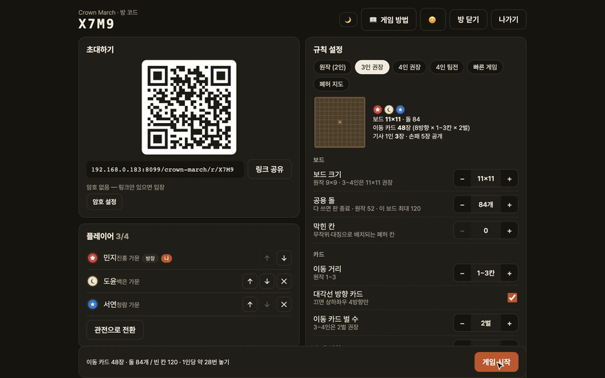 |
| **첫 화면 · 게임 방법** | **기사로 상대 돌 뒤집기** |
|  |  |

### 모든 게임 (실제 앱을 봇과 돌려 녹화)

<!-- gallery:start -->

| | |
|---|---|
| **Bluff Dice · 허풍 주사위**<br> | **Cipher Ops · 암호 작전**<br>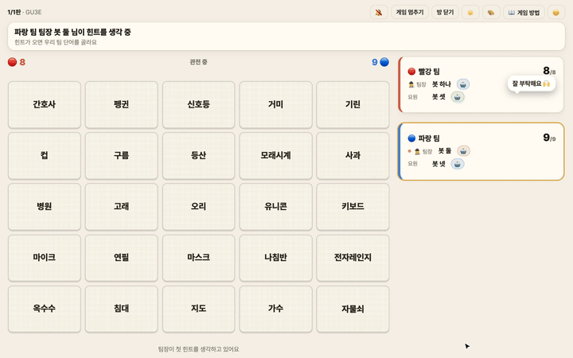 |
| **Corner Claim · 모서리 땅따먹기**<br> | **Court Intrigue · 궁정 음모**<br> |
| **Domain Tiles · 영지 도미노**<br>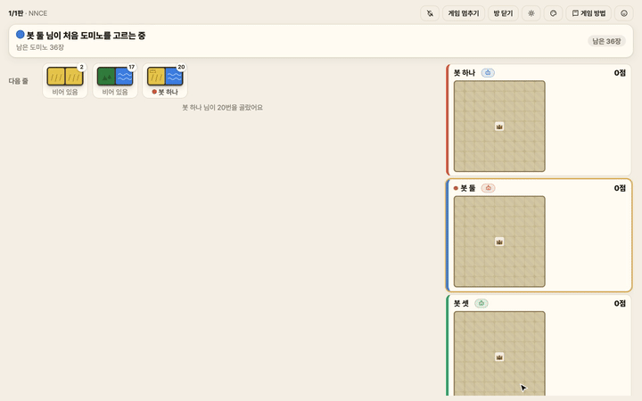 | **Five Stones · 오목**<br>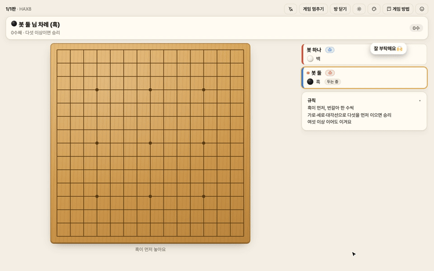 |
| **Flag Line · 깃발 전선**<br>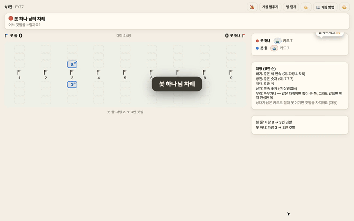 | **Flare Signals · 불꽃 신호**<br>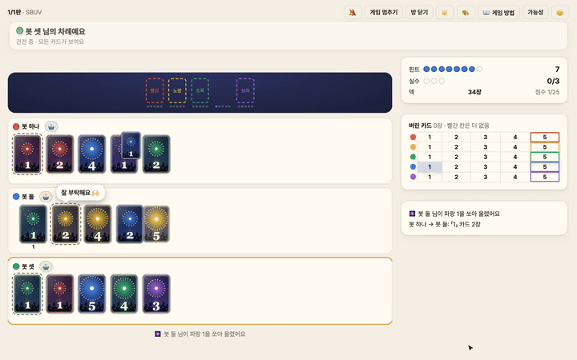 |
| **Gem Guild · 보석 상단**<br>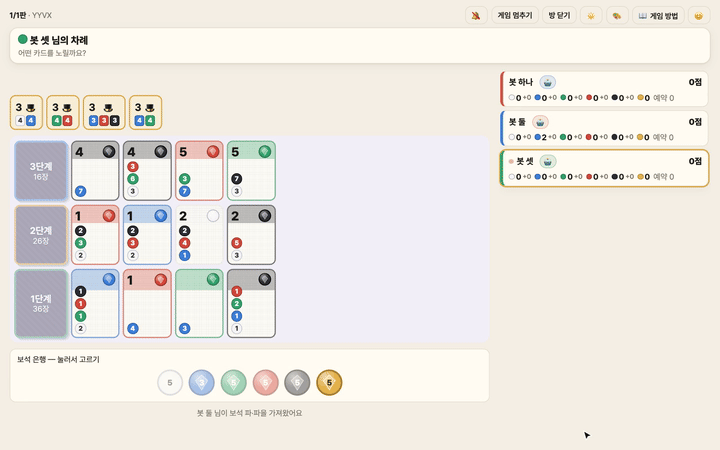 | **Go Stop · 고스톱**<br>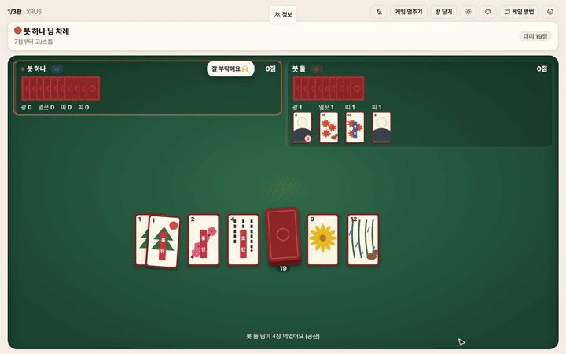 |
| **Hearts · 하트**<br>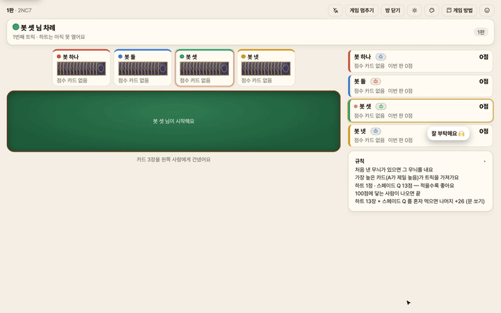 | **Hidden Thorn · 숨은 가시**<br>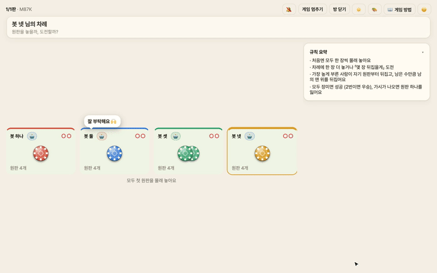 |
| **Hold'em · 홀덤**<br>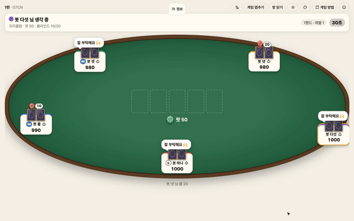 | **Number Runs · 숫자 잇기**<br> |
| **Number Vault · 숫자 금고**<br>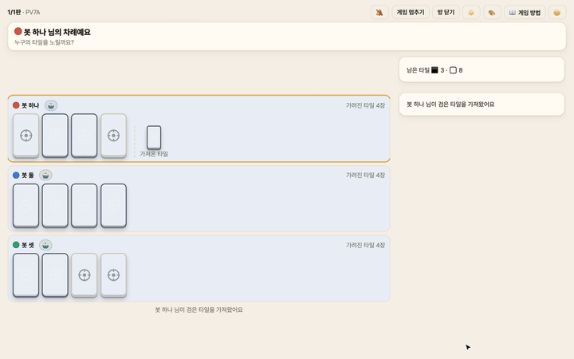 | **One Card · 원카드**<br>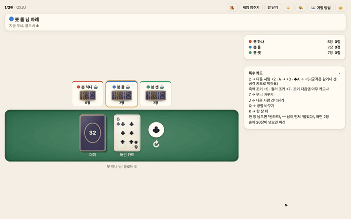 |
| **One Word · 한 단어**<br>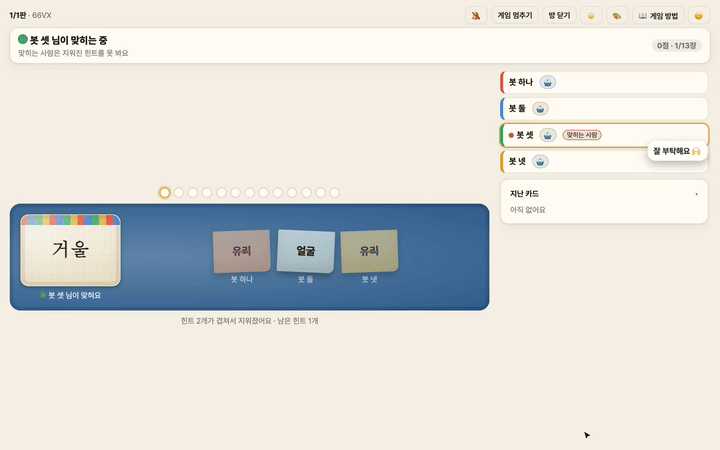 | **Orbit Tasks · 궤도 임무**<br>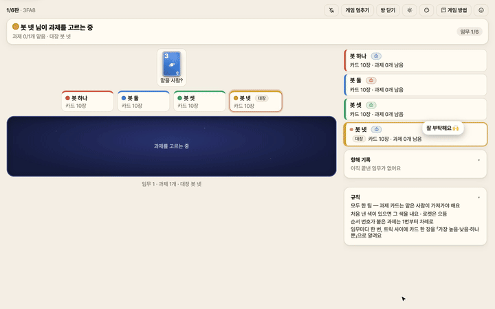 |
| **Pass the Plate · 접시 돌리기**<br> | **Row Six · 여섯째 줄**<br>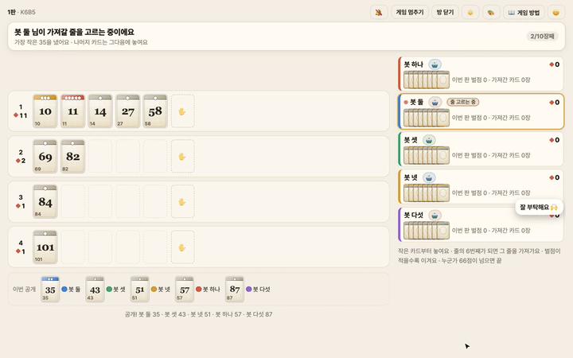 |
| **Sealed Letter · 비밀 편지**<br> | **Secret Mission · 비밀 원정대**<br>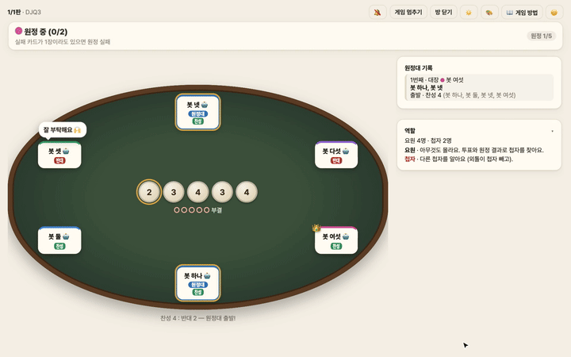 |
| **Silent Count · 침묵의 숫자**<br>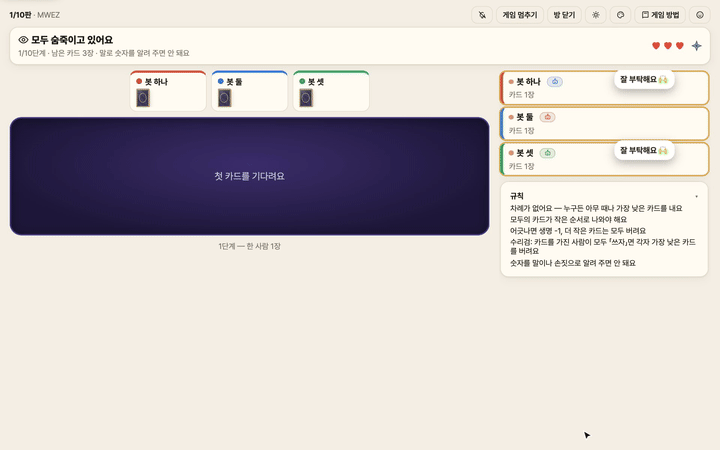 | **Sketch Quiz · 그림 퀴즈**<br>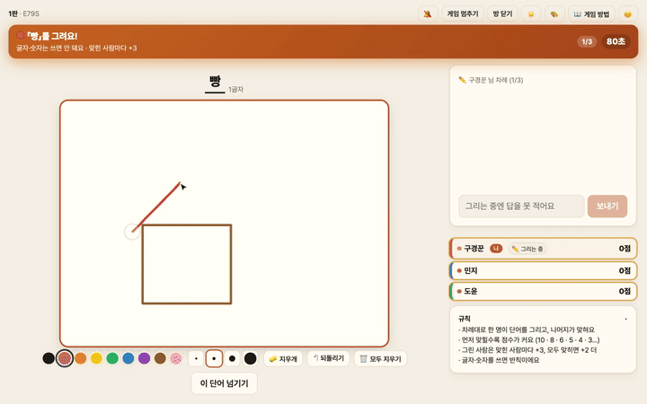 |
| **Tile Atelier · 타일 공방**<br> | **Trio Hunt · 셋 찾기**<br>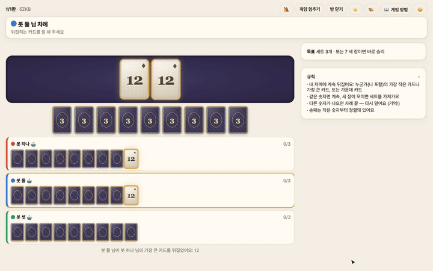 |
| **Yacht Dice · 요트 다이스**<br>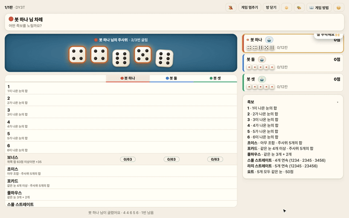 |  |

<!-- gallery:end -->

### 휴대폰

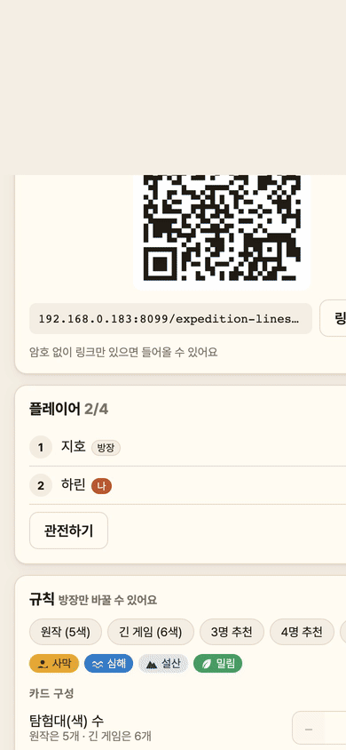 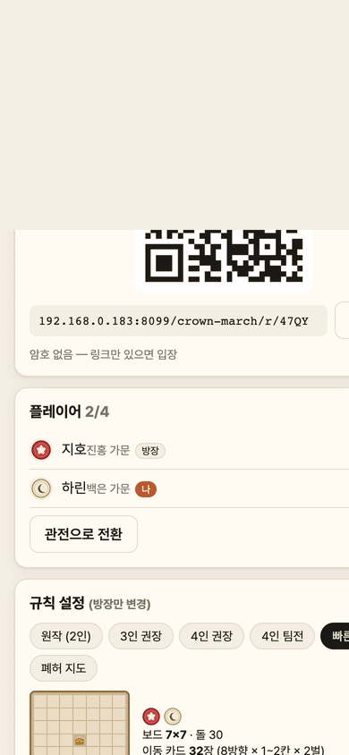

> 영상·GIF는 `npm run build && npm run media`로 실제 앱을 봇과 함께 돌려 녹화한 것이다 (`scripts/media/`). 봇이 없는 게임(그림 퀴즈)은 손님 창을 열어 함께 녹화한다.

## 모든 게임에 공통인 것

**방과 사람**
- 방 코드 4자리 + QR/공유 링크, 선택적 방 암호, 관전, 끊겨도 같은 기기로 다시 열면 자동 복귀, 방장 승계·강퇴·순서 변경
- **다른 게임으로 바꾸기**: 방장이 대기실에서 게임을 바꾸면 모두(봇 포함) 새 게임 방으로 함께 옮겨 간다
- **첫 화면 방 목록**: 지금 열린 방을 보고 바로 들어가거나 관전 (방장이 숨길 수 있음)
- **봇**: 빈자리에 쉬움·보통·어려움 봇. 모든 게임이 같은 봇 모듈(`packages/core/src/bot.ts`)을 쓰고, 봇이 제대로 할 수 없는 게임(그림 퀴즈)은 봇을 끈다

**규칙과 진행**
- 방장의 규칙 설정(프리셋 + 세부 조절), 게임 중지 → 설정 바꿔 이어서 하기, 판 수·턴 제한시간, 끊긴 차례 대신 진행
- **동시 진행·끼어들기**: 모두가 동시에 고르는 게임, 도전·막기 대기 창을 플랫폼이 처리 (`actors`, `timerSec`, `phaseKey`)

**화면과 손맛**
- 기기 화면에 고정되는 반응형 레이아웃 + 화면 맞춤 배율, 라이트/다크/시스템 테마(포털·게임 공유)
- 직접 그린 **SVG 아이콘**(테마 색을 그대로 따름), 카드·칩 키트(크림 테두리·광택·세리프 숫자·카지노 칩), 카드별 일러스트
- **카드·칩 꾸미기**: 카드 뒷면 8종(+ 내 그림), 앞면 질감 5종, 칩 질감 5종. 모든 게임 공통, 이 기기에 저장
- 움직임: 자리를 옮기는 카드는 미끄러지고(`data-flip`), 새 판마다 **카드를 섞고 나눠 주며**(`deal-fx`), 요트는 **물리 엔진으로 구르는 3D 주사위**, 로우 식스는 놓기·줄 가져가기를 한 장씩 **재생**
- 끌어다 놓기(블록·카드·타일), 그림판(그림 퀴즈), 도구에 맞는 효과음 29종(WebAudio 합성), 차례 배너·알림음·진동·감정 표현
- 게임 방법 모달(그림·영상), 게임마다 **원작 이름** 표시 (팬 제작 버전)

**운영**
- **모니터링**: Prometheus 지표 + Grafana 「보드게임 테이블」 대시보드·알림 (`docs/monitoring.md`)
- **무중단 배포**: 롤링 업데이트 때 새 서버가 이전 서버의 방 상태를 넘겨받아 진행 중인 게임이 끊기지 않는다

## 구조

```
packages/core     GameModule 계약 · 방 화면 타입 · 봇 · 감정 표현 · 게임 카탈로그 · 검색
packages/server   게임 무관 방 서버 (Rooms, createGameServer, 무중단 배포 handoff)
packages/ui       디자인 시스템 (토큰·테마·아이콘·카드·칩·공용 컴포넌트) — README, 포털 /design
packages/web      게임 웹 키트 (첫 화면·초대·로비·재접속·테이블 레이아웃·움직임·효과음·게임 방법 틀)
games/<id>/       engine · server · web · meta.ts · deploy/   ← 게임마다 따로 배포
apps/portal/      홈 · 게임 찾기 · 상세 · /design · deploy/
tests/e2e/        브라우저 E2E (끌어다 놓기 · 게임 바꾸기)
```

자세히: [`docs/architecture.md`](docs/architecture.md) · 디자인 시스템: [`packages/ui/README.md`](packages/ui/README.md) ·
**새 게임 추가 절차와 노하우: [`.claude/skills/new-boardgame/SKILL.md`](.claude/skills/new-boardgame/SKILL.md)** ·
문구 쓰는 법: [`docs/ux-writing.md`](docs/ux-writing.md) ·
게임별 규칙 조사·설계·QA: [`docs/games/`](docs/games) · QA 기록: [`docs/qa/`](docs/qa)

## 개발

```bash
npm install
npm test                         # 엔진(+봇 대전·퍼즈)·방 흐름·검색 단위 테스트 (vitest)
npm run typecheck
npm run build && npm run local   # 운영처럼 경로로 나눠 http://localhost:8080 (포털 + 모든 게임)
```

브라우저로 확인하는 검사 (빌드 뒤, 크롬 필요 · `PW_CHROMIUM=크롬 경로`, 없으면 Playwright 크롬을 찾아 씀):

```bash
npm run test:e2e                 # 끌어다 놓기(5종 × 넓은·폰·가로 짧은 화면 × 마우스·터치) · 게임 바꾸기
E2E_GAMES=corner-claim E2E_VIEWS=phone E2E_INPUTS=touch npm run test:e2e   # 일부만
node scripts/qa/readability.mjs [게임id …]   # 숫자 글자 대비·크기 검사
node scripts/qa/mobile-fit.mjs [게임id …]   # 폰·작은 폰·폰 가로에서 내 손패·버튼이 스크롤 없이 보이나
node scripts/qa/playthrough.mjs [게임id …]  # 봇으로 끝까지 돌리며 화면 문제 찾기 (QA_MODE=player: 직접 눌러 봄)
npm run media                    # README·포털 표지·게임 방법 영상 다시 녹화 (ffmpeg 필요)
node scripts/docs/readme-games.mjs           # README 게임 표·미리보기 다시 만들기
```

E2E는 서버를 스스로 띄운다. 이미 띄운 서버를 쓰려면 `E2E_ORIGIN=http://localhost:8080`. 실패하면 그 장면을 `out/e2e/`에 남긴다.

게임 하나만 개발 서버로: `npm run dev -w @bg/<id>-server` + `npm run dev -w @bg/<id>-web`.

## 배포

- 서브 프로젝트(포털·각 게임)마다 `release-<target>.yml` → `ghcr.io/shinkeonkim/boardgame-<target>:sha-xxxx` → `<dir>/deploy/kustomization.yaml` 태그 갱신 → ArgoCD(oh-my-homelab `helm-charts/apps/boardgame-<target>.yaml`).
- 공개: Cloudflare Tunnel `boardgame.shinkeonkim.com` → Traefik이 경로로 나눔 (`/<게임id>` → 게임, 나머지 → 포털). 게임을 추가해도 터널은 그대로.
