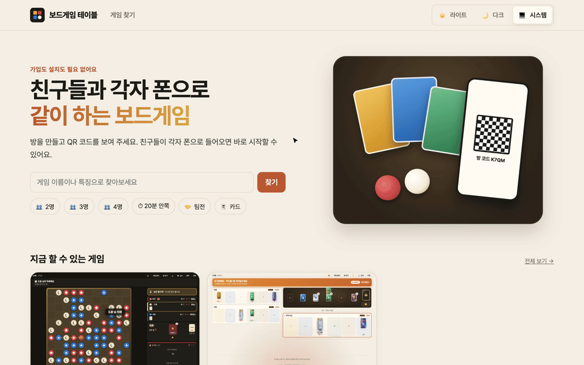
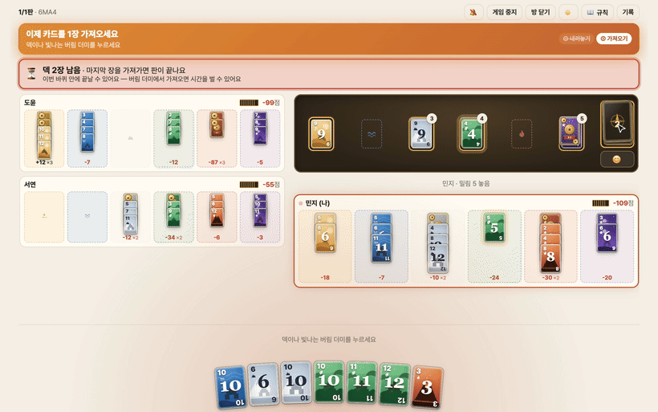
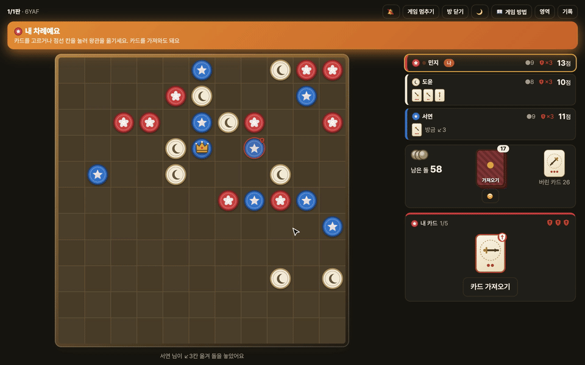
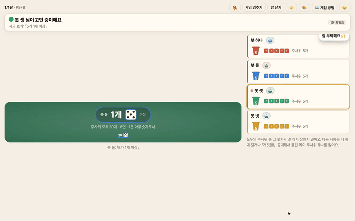
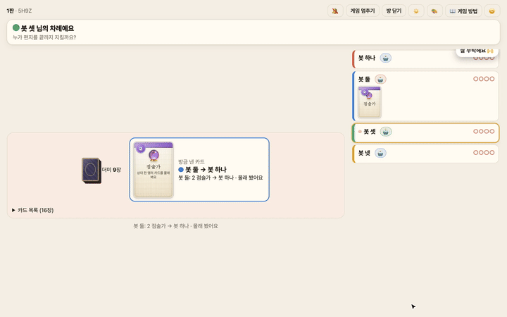
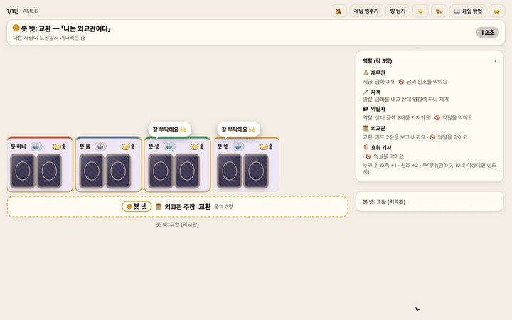
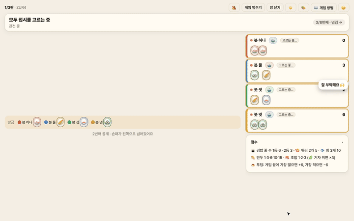
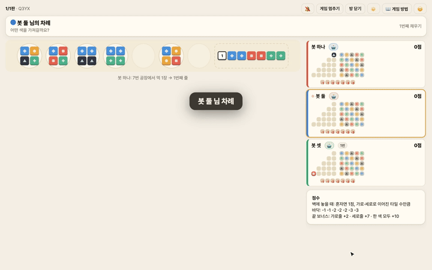
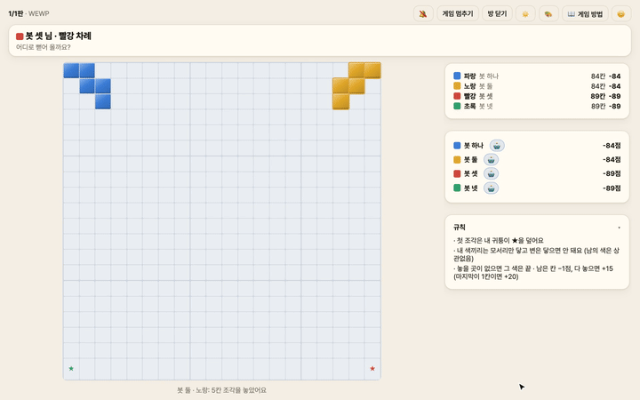
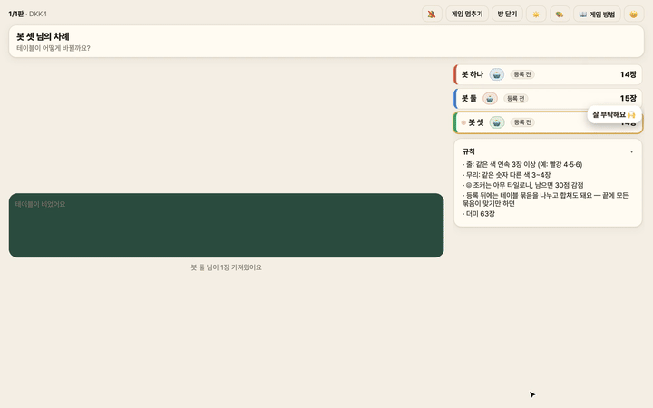

# 보드게임 테이블

친구들과 **각자 휴대폰으로** 바로 즐기는 온라인 보드게임 모음. 방을 만들고 QR을 보여 주면 모두 같은 판에 들어온다. 회원가입·설치 없음.

**바로 플레이:** https://boardgame.shinkeonkim.com

<p align="center"></p>

| 게임 | 원작 | 인원 | 시간 | 한 줄 소개 |
|---|---|---|---|---|
| [Expedition Lines · 탐험대](https://boardgame.shinkeonkim.com/games/expedition-lines) | 로스트 시티 | 2~4 | 15~30분 | 같은 색 카드를 작은 숫자부터 쌓아 탐험대를 키우는 손패 관리 카드 게임 |
| [Crown March · 왕관 행진](https://boardgame.shinkeonkim.com/games/crown-march) | 장미전쟁 | 2~4 | 20~30분 | 모두가 함께 움직이는 왕관을 옮겨 영토를 넓히는 추상 전략 게임 |
| [Row Six · 여섯째 줄](https://boardgame.shinkeonkim.com/games/row-six) | 젝스님트 | 2~10 | 15~30분 | 모두 동시에 숫자 카드를 내고, 6번째가 되면 줄을 떠안는 눈치 게임 |
| [Flare Signals · 불꽃 신호](https://boardgame.shinkeonkim.com/games/flare-signals) | 하나비 | 2~6 | 20~30분 | 내 카드만 못 보는 채로 힌트를 주고받는 협력 불꽃놀이 |
| [Cipher Ops · 암호 작전](https://boardgame.shinkeonkim.com/games/cipher-ops) | 코드네임 | 4~10 | 15~25분 | 팀장만 아는 정답 지도를 한 단어 힌트로 전하는 팀 단어 연상 |
| [Bluff Dice · 허풍 주사위](https://boardgame.shinkeonkim.com/games/bluff-dice) | 라이어 다이스 | 2~8 | 15~25분 | 컵 속 주사위로 「몇 개 이상」을 걸고 거짓말을 잡아내기 |
| [Number Vault · 숫자 금고](https://boardgame.shinkeonkim.com/games/number-vault) | 다빈치 코드 | 2~6 | 15~25분 | 오름차순으로 가려진 숫자 타일을 색과 위치로 추리 |
| [Sealed Letter · 비밀 편지](https://boardgame.shinkeonkim.com/games/sealed-letter) | 러브레터 | 2~6 | 10~20분 | 손에 든 한 장을 지키며 추측·엿보기·결투 |
| [Court Intrigue · 궁정 음모](https://boardgame.shinkeonkim.com/games/court-intrigue) | 쿠 | 2~6 | 10~20분 | 역할을 주장하고 거짓말을 도전으로 밝히는 허풍 게임 |
| [Pass the Plate · 접시 돌리기](https://boardgame.shinkeonkim.com/games/pass-the-plate) | 스시 고! | 2~8 | 15~20분 | 한 접시 고르고 나머지는 옆으로 — 동시 드래프트 |
| [Hidden Thorn · 숨은 가시](https://boardgame.shinkeonkim.com/games/hidden-thorn) | 스컬 | 2~8 | 15~30분 | 장미 사이 가시를 숨기고 뒤집을 수를 거는 블러핑 |
| [Flag Line · 깃발 전선](https://boardgame.shinkeonkim.com/games/flag-line) | 배틀라인 | 2·4(팀) | 20~30분 | 아홉 깃발을 3장 대형으로 겨루는 진지전 |
| [Gem Guild · 보석 상단](https://boardgame.shinkeonkim.com/games/gem-guild) | 스플렌더 | 2~6 | 30~45분 | 보석으로 카드를 사고 보너스로 엔진을 키우기 |
| [Tile Atelier · 타일 공방](https://boardgame.shinkeonkim.com/games/tile-atelier) | 아줄 | 2~4 | 30~45분 | 공장에서 한 색을 가져와 벽을 꾸미는 타일 드래프트 |
| [Corner Claim · 모서리 땅따먹기](https://boardgame.shinkeonkim.com/games/corner-claim) | 블로커스 | 2~4 | 20~30분 | 내 조각끼리 모서리로만 — 폴리오미노 공간 퍼즐 |
| [Number Runs · 숫자 잇기](https://boardgame.shinkeonkim.com/games/number-runs) | 루미큐브 | 2~6 | 30~60분 | 줄과 무리로 묶고 테이블을 다시 짜 손을 비우기 |
| [Yacht Dice · 요트 다이스](https://boardgame.shinkeonkim.com/games/yacht) | 요트 | 1~8 | 10~25분 | 주사위 5개를 세 번까지 굴려 족보 칸을 채우는 고전 주사위 게임 |
| [Secret Mission · 비밀 원정대](https://boardgame.shinkeonkim.com/games/secret-mission) | 레지스탕스 | 5~10 | 20~40분 | 숨은 첩자를 찾아라 — 원정대 투표와 몰래 낸 카드로 추리하는 파티 게임 |
| [One Card · 원카드](https://boardgame.shinkeonkim.com/games/one-card) | 원카드 | 2~8 | 10~25분 | 무늬나 숫자를 맞춰 먼저 다 내기 — 공격 쌓기와 「원카드!」 |

게임 규칙 메커니즘은 고전 보드게임에서 영감을 받았고, 이름·그림·화면은 모두 직접 만들었다.

## 미리보기

### 포털 — 게임 찾기, 라이트/다크 전환



### Expedition Lines

| 첫 화면 · 게임 방법 | 끌어서 내려놓기 |
|---|---|
|  |  |
| **버림 더미 펼쳐보기** | **마지막 차례와 점수표** |
|  |  |

### Crown March

| 첫 화면 · 게임 방법 | 카드로 왕관 옮기기 |
|---|---|
|  |  |
| **기사로 상대 돌 뒤집기** | **남은 돌 경고와 결과** |
|  |  |

### 2026-11 추가된 14종 (봇끼리 두는 장면)

| | |
|---|---|
| **Row Six · 여섯째 줄**<br> | **Flare Signals · 불꽃 신호**<br> |
| **Cipher Ops · 암호 작전**<br> | **Bluff Dice · 허풍 주사위**<br> |
| **Number Vault · 숫자 금고**<br> | **Sealed Letter · 비밀 편지**<br> |
| **Court Intrigue · 궁정 음모**<br> | **Pass the Plate · 접시 돌리기**<br> |
| **Hidden Thorn · 숨은 가시**<br> | **Flag Line · 깃발 전선**<br> |
| **Gem Guild · 보석 상단**<br> | **Tile Atelier · 타일 공방**<br> |
| **Corner Claim · 모서리 땅따먹기**<br> | **Number Runs · 숫자 잇기**<br> |

### 휴대폰

 

> 영상·GIF는 `npm run build && npm run media`로 실제 앱을 봇과 함께 돌려 2배 픽셀로 녹화한 것이다 (`scripts/media/`).

## 모든 게임에 공통인 것 (플랫폼)

- 방 코드 4자리 + QR/공유 링크, 선택적 방 암호, 관전, 끊겨도 같은 기기로 다시 열면 자동 복귀, 방장 승계·강퇴·순서 변경
- 방장의 규칙 설정(프리셋 + 세부 조절), 게임 중지 → 설정 바꿔 이어서 하기, 판 수·턴 제한시간, 끊긴 차례 대신 진행
- 차례 배너·전환 스플래시·알림음·진동, 감정 표현(🍵 티배깅 같은 약올리기 포함), 게임 방법 모달(그림·영상)
- 기기 화면에 고정되는 반응형 레이아웃 + **화면 맞춤 배율**(큰 모니터·태블릿에서 작게 보이지 않게), 라이트/다크/시스템 테마(포털·게임 공유)
- **카드·칩 꾸미기 🎨**: 카드 뒷면 8종(+ 내 그림), 앞면 질감 5종, 칩 질감 5종 — 모든 게임 공통, 이 기기에 저장 (`packages/ui/src/skins.ts`에 한 줄 추가로 새 무늬)
- 카드·타일이 자리를 옮길 때 미끄러지는 움직임(`data-flip`), 블록 놓기·타일 묶기는 끌어다 놓기
- 카드·칩 키트(크림 테두리·광택·세리프 숫자·카지노 칩) · 도구에 맞는 효과음 29종(WebAudio 합성) · 가독성 검사(`scripts/qa/readability.mjs`)
- 게임마다 **원작 이름** 표시 (원작 규칙을 바탕으로 직접 만든 팬 제작 버전)
- **봇**: 방장이 빈자리에 쉬움·보통·어려움 봇을 넣어요. 모든 게임이 같은 봇 모듈(`packages/core/src/bot.ts`)을 써요
- **첫 화면 방 목록**: 지금 열린 방을 보고 바로 들어가거나 관전 (방장이 숨길 수 있어요)
- **동시 진행·끼어들기**: 모두가 동시에 고르는 게임, 도전·막기 대기 창을 플랫폼이 처리 (`actors`, `timerSec`)
- **모니터링**: Prometheus 지표 + Grafana 「보드게임 테이블」 대시보드·알림 (`docs/monitoring.md`)
- **무중단 배포**: 롤링 업데이트 때 새 서버가 이전 서버의 방 상태를 넘겨받아 진행 중인 게임이 끊기지 않는다

## 구조

```
packages/core     GameModule 계약 · 방 화면 타입 · 감정 표현 · 게임 카탈로그 · 검색
packages/server   게임 무관 방 서버 (Rooms, createGameServer, 무중단 배포 handoff)
packages/ui       디자인 시스템 (토큰·테마·공용/게임 컴포넌트) — README, 포털 /design
packages/web      게임 웹 키트 (첫 화면·초대·로비·재접속·게임 방법 틀)
games/<id>/       engine · server · web · meta.ts · deploy/   ← 게임마다 따로 배포
apps/portal/      홈 · 게임 찾기 · 상세 · /design · deploy/
```

자세히: [`docs/architecture.md`](docs/architecture.md) · 디자인 시스템: [`packages/ui/README.md`](packages/ui/README.md) ·
**새 게임 추가 절차와 노하우: [`.claude/skills/new-boardgame/SKILL.md`](.claude/skills/new-boardgame/SKILL.md)** ·
문구 쓰는 법: [`docs/ux-writing.md`](docs/ux-writing.md) ·
게임별 규칙 조사·설계·QA: [`docs/games/`](docs/games)

## 개발

```bash
npm install
npm test              # 엔진(+퍼즈)·방 흐름·검색 테스트
npm run typecheck
npm run build && npm run local   # 운영처럼 경로로 나눠 http://localhost:8080 (포털 + 모든 게임)
npm run media         # README·포털 표지·게임 방법 영상 다시 녹화 (ffmpeg + 크롬, PW_CHROMIUM=크롬 경로)
```

게임 하나만 개발 서버로: `npm run dev -w @bg/<id>-server` + `npm run dev -w @bg/<id>-web`.

## 배포

- 서브 프로젝트(포털·각 게임)마다 `release-<target>.yml` → `ghcr.io/shinkeonkim/boardgame-<target>:sha-xxxx` → `<dir>/deploy/kustomization.yaml` 태그 갱신 → ArgoCD(oh-my-homelab `helm-charts/apps/boardgame-<target>.yaml`).
- 공개: Cloudflare Tunnel `boardgame.shinkeonkim.com` → Traefik이 경로로 나눔 (`/<게임id>` → 게임, 나머지 → 포털). 게임을 추가해도 터널은 그대로.
